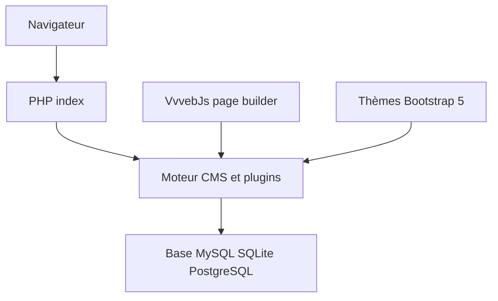

# givanz/Vvveb

> CMS PHP avec éditeur de pages par glisser-déposer, pour sites, blogs et boutiques en ligne.

## Le problème
Monter un site ou une boutique demande souvent un CMS lourd. Celui-ci vise une faible empreinte et un éditeur visuel intégré.

## Ce que ça fait vraiment
Un CMS multisite, multilingue, avec e-commerce (paiement en une page, abonnements, variantes, coupons), marketplace de thèmes et plugins, sauvegardes, import/export. Il sert aussi de CMS sans tête via GraphQL et REST. Fonctionne avec MySQL, MariaDB, SQLite ou PostgreSQL, et un seul fichier PHP exposé.

## Comment c'est branché
Schéma simplifié d'après la fiche, sans diagramme fourni.



## Essayer
```bash
git clone --recurse-submodules https://github.com/givanz/Vvveb
./build.sh
php cli.php install module=index host=127.0.0.1 user=root password=1234 database=vvveb admin[email]=admin@vvveb.com admin[password]=admin engine=mysqli
```

## Coût et pièges
Gratuit, hébergement PHP 7.4 minimum (8.3 conseillé) et une base à prévoir. Le README prend `admin` comme exemple de mot de passe : à changer. Une centaine d'issues ouvertes.

## Ce que ce n'est pas
Pas un outil data ou IA. Le README met en avant la vitesse sans donner de mesure.

## Alternatives
Aucune alternative nommée dans le README.

## Pour toi
À ignorer : un CMS web généraliste, hors sujet pour un profil data, IA ou MLOps, et porté par un seul mainteneur.

