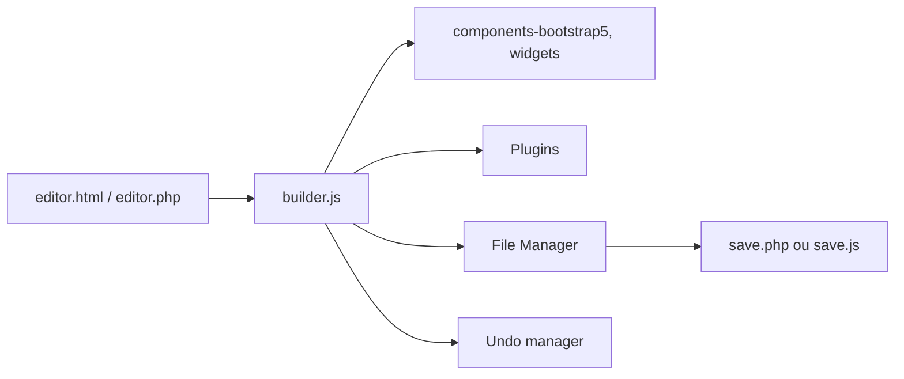

# givanz/VvvebJs

> JavaScript drag-and-drop page builder library, written in pure JS with Bootstrap 5.

## The problem
Offering non-developers a visual web page editor without integrating a heavy framework.

## What it actually does
Editor with components and blocks, undo/redo, file manager, CodeMirror code editor, media gallery, Google fonts, widgets (YouTube, Google Maps, Charts.js) and page export or save. It is extensible through plugins (CKEditor, JSZip, an AI assistant). Saving and uploading images require a small PHP (`save.php`) or Node (`save.js`) backend.

## How it is wired


## Trying it
```bash
git clone --recurse-submodules https://github.com/givanz/VvvebJs
docker run -p 8080:80 vvveb/vvvebjs
npm install express
node save.js
```
Then open http://localhost:8080/editor.html.

## Cost and gotchas
Free. A web server is needed (the iframe forbids `file://` mode) and PHP or Node to save. The README shows launching Chrome with `--disable-web-security`: reserve that for a throwaway profile.

## What it is not
It is not a CMS: the README points to Vvveb CMS for that. Detailed documentation is in the wiki.

## Alternatives
Vvveb CMS is named for full CMS use; a React wrapper is mentioned.

## For you
Ignore: web page builder outside the data/AI/MLOps scope.
