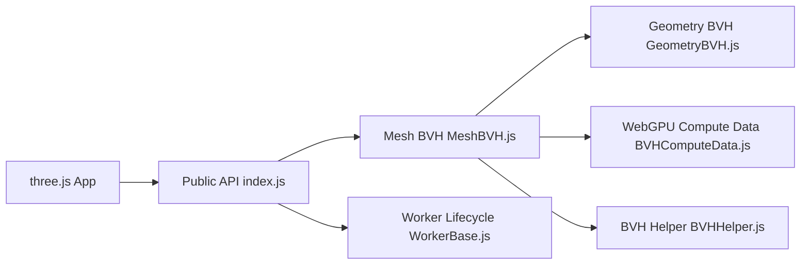

# gkjohnson/three-mesh-bvh

> Bounding volume hierarchy to accelerate raycasting and spatial queries on three.js meshes.

## The problem
three.js's native raycasting tests every triangle: too slow on large models.

## What it actually does
Builds a BVH on a geometry and replaces `Mesh.raycast`. Also provides BVHs for points, lines, skinned meshes and object hierarchies, direct queries (shapecast, sphere), serialization, worker-based generation (parallel with SharedArrayBuffer) and WebGL/WebGPU shader queries. The README cites 500 rays on 80,000 polygons at 60 fps.

## How it is wired


## Trying it
```bash
npm start
```
Then open `localhost:5173/<name>.html` for an example from the `example` folder. The usage code is in JavaScript in the README.

## Cost and gotchas
The BVH is not dynamic: no morph targets or skinning (except `SkinnedMeshBVH`); you must regenerate or `refit` if the geometry changes. Center large geometries for floating-point precision.

## What it is not
Not a complete 3D or physics engine. Some features (worker, serialization) are not supported for point/line BVHs.

## Alternatives
No alternative named in the README (three-gpu-pathtracer and three-bvh-csg are listed as external projects that use it).

## For you
Ignore for a data/AI profile, unless you have a web 3D visualization project: excellent in its domain but unrelated to your needs.
