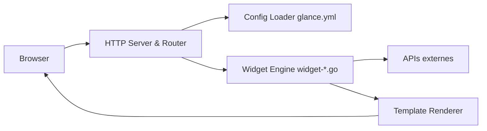

# glanceapp/glance

> Self-hosted dashboard aggregating RSS feeds, Reddit, weather and markets, configured in YAML.

## The problem
Following your sources (feeds, repositories, videos, container status) forces you to open ten tabs.

## What it actually does
A single Go binary (<20 MB) that reads `glance.yml`, fetches each widget's data on page load, caches it, and renders HTML via Go templates with embedded assets. Widgets for RSS, Hacker News, Reddit, YouTube, Twitch, markets, GitHub releases, Docker, server stats, plus custom widgets (`custom-api`, `html`, `iframe`).

## How it is wired


## Trying it
```bash
mkdir glance && cd glance && curl -sL https://github.com/glanceapp/docker-compose-template/archive/refs/heads/main.tar.gz | tar -xzf - --strip-components 2
docker compose up -d
go build -o build/glance .
```

## Cost and gotchas
Free. No background refresh: you must reload the page. Ad-blocking DNS (Pi-Hole) can cause timeouts.

## What it is not
Not a monitoring or alerting tool; no real-time data.

## Alternatives
None named in the README.

## For you
Handy for a personal watch dashboard (releases, feeds); outside MLOps tooling.
