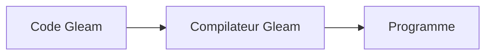

# gleam-lang/gleam

> A typed, approachable programming language for building systems that scale.

## The problem
Writing concurrent systems with safe typing, without the complexity of heavier languages.

## What it actually does
The README contains only one sentence: Gleam is a friendly language for type-safe systems that scale, with a pointer to the website. Nothing else is documented here.

## How it is wired
Simplified diagram based on the sheet, no diagram provided.

## Trying it
No command documented in the README.

## Cost and gotchas
Free (Apache-2.0). Installation and execution targets not documented in the README.

## What it is not
Not a data science tool. The README says nothing about the ecosystem: assume nothing.

## Alternatives
No alternative named in the README.

## For you
Ignore: a general-purpose language with no data or AI libraries highlighted, and a README that does not justify a trial.
