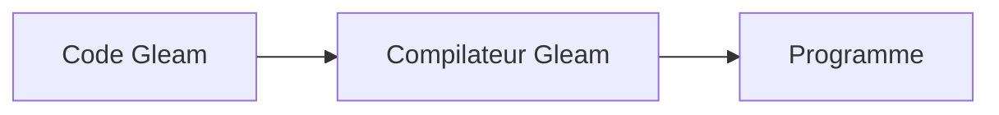

# gleam-lang/gleam

> Langage de programmation typé et accessible pour construire des systèmes qui passent à l'échelle.

## Le problème
Écrire des systèmes concurrents avec un typage sûr, sans la complexité de langages plus lourds.

## Ce que ça fait vraiment
Le README ne contient qu'une phrase : Gleam est un langage amical pour des systèmes sûrs au typage et qui passent à l'échelle, avec renvoi vers le site web. Rien d'autre n'est documenté ici.

## Comment c'est branché
Schéma simplifié d'après la fiche, sans diagramme fourni.

## Essayer
Aucune commande documentée dans le README.

## Coût et pièges
Gratuit (Apache-2.0). Installation et cibles d'exécution non documentées dans le README.

## Ce que ce n'est pas
Pas un outil de data science. Le README ne dit rien de l'écosystème : ne rien supposer.

## Alternatives
Aucune alternative nommée dans le README.

## Pour toi
À ignorer : un langage généraliste sans bibliothèques data ou IA mises en avant, et un README qui ne permet pas de justifier un essai.

