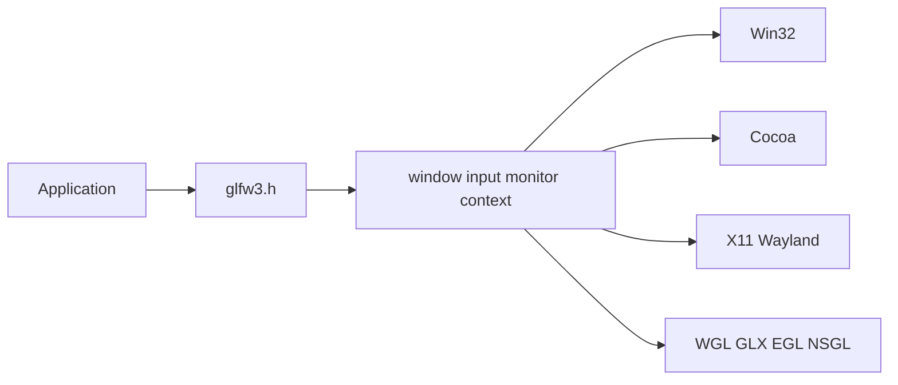

# glfw/glfw

> Cross-platform C library for creating windows and OpenGL/Vulkan contexts and reading input.

## The problem
Opening a window and a graphics context, and handling keyboard and mouse, identically on Windows, macOS and Linux.

## What it actually does
A public API (`glfw3.h`) on top of a platform-independent core (windows, input, monitors, contexts, Vulkan) and Win32, Cocoa, X11, Wayland and null implementations. Contexts via WGL, GLX, EGL, NSGL, OSMesa.

## How it is wired

## Trying it
No command is documented in the README; it points to the compilation guide (CMake required).

## Cost and gotchas
Free, Zlib license. Under GNOME Wayland, window decorations are rudimentary without libdecor. Last push: 2026-08-04.

## What it is not
Not a game engine nor an OpenGL extension loader (glad is provided for the examples).

## Alternatives
No alternative named in the README.

## For you
Ignore, unless you do 3D visualization or in-house graphics tools; it is already a dependency of MuJoCo (simulate).
