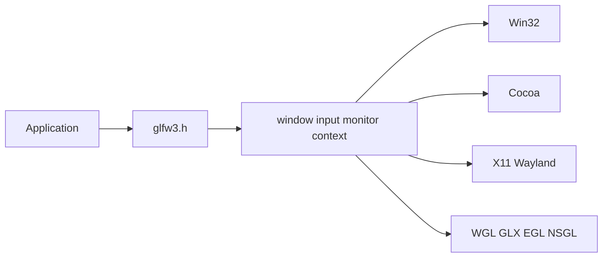

# glfw/glfw

> Bibliothèque C multiplateforme pour créer fenêtres, contextes OpenGL/Vulkan et lire les entrées.

## Le problème
Ouvrir une fenêtre et un contexte graphique, gérer clavier et souris, de façon identique sous Windows, macOS, Linux.

## Ce que ça fait vraiment
API publique (`glfw3.h`) au-dessus d'un cœur indépendant de la plateforme (fenêtres, entrées, moniteurs, contextes, Vulkan) et d'implémentations Win32, Cocoa, X11, Wayland et nulle. Contextes via WGL, GLX, EGL, NSGL, OSMesa.

## Comment c'est branché

## Essayer
Aucune commande documentée dans le README ; il renvoie au guide de compilation (CMake requis).

## Coût et pièges
Gratuit, licence Zlib. Sous GNOME Wayland, les décorations sont rudimentaires sans libdecor. Dernier push : 2026-08-04.

## Ce que ce n'est pas
Pas un moteur de jeu ni un chargeur d'extensions OpenGL (glad est fourni pour les exemples).

## Alternatives
Aucune alternative nommée dans le README.

## Pour toi
Ignorer, sauf visualisation 3D ou outils graphiques maison ; il est déjà une dépendance de MuJoCo (simulate).

