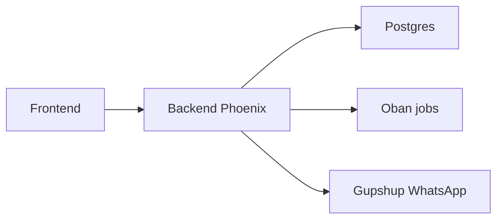

# glific/glific

> Open source two-way WhatsApp communication platform, for NGOs and social-impact organizations.

## The problem
NGOs need to automate WhatsApp messaging with beneficiaries without paying for a proprietary platform.

## What it actually does
The README only describes installing the Elixir/Phoenix backend: Erlang/Elixir via asdf, Postgres, mkcert certificates, Gupshup for WhatsApp, Oban (Pro or free version), SSL configuration, separate frontend. Product features point to external links.

## How it is wired


## Trying it
```bash
asdf install
cp config/.env.dev.txt config/.env.dev
mix deps.get
mix setup
iex -S mix phx.server
```

## Cost and gotchas
Gupshup account required; Oban Pro is paid in production. Long installation (certificates, hosts, SSL).

## What it is not
Not a ready-to-use AI chatbot: it is a messaging platform.

## Alternatives
No alternative named in the README.

## For you
Ignore: an Elixir messaging platform dependent on Gupshup, far from your data/AI core.
