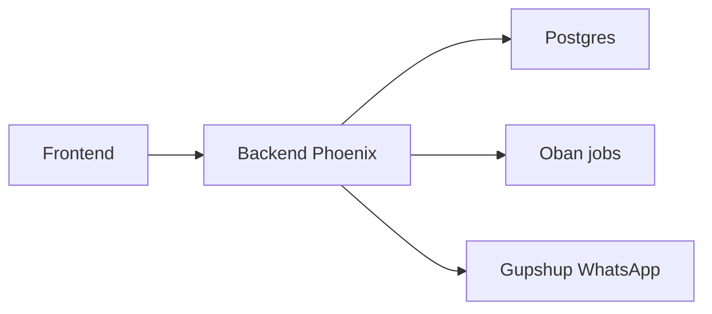

# glific/glific

> Plateforme open source de communication bidirectionnelle sur WhatsApp, pour ONG et acteurs à impact social.

## Le problème
Les ONG ont besoin d'automatiser la messagerie WhatsApp avec les bénéficiaires sans payer une plateforme propriétaire.

## Ce que ça fait vraiment
Le README ne décrit que l'installation du backend Elixir/Phoenix : Erlang/Elixir via asdf, Postgres, certificats mkcert, Gupshup pour WhatsApp, Oban (Pro ou version libre), configuration SSL, frontend séparé. Les fonctions produit renvoient à des liens externes.

## Comment c'est branché


## Essayer
```bash
asdf install
cp config/.env.dev.txt config/.env.dev
mix deps.get
mix setup
iex -S mix phx.server
```

## Coût et pièges
Compte Gupshup requis ; Oban Pro payant en production. Installation longue (certificats, hosts, SSL).

## Ce que ce n'est pas
Pas un chatbot IA prêt à l'emploi : c'est une plateforme de messagerie.

## Alternatives
Aucune alternative nommée dans le README.

## Pour toi
À ignorer : plateforme de messagerie Elixir dépendante de Gupshup, loin de ton cœur data/IA.

