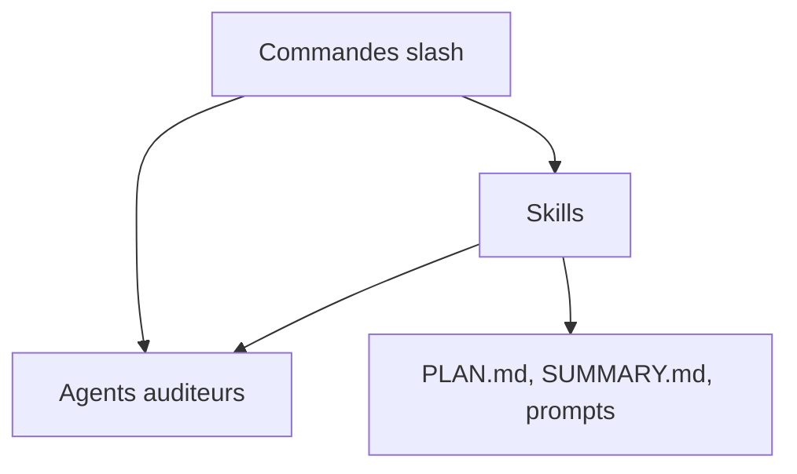

# glittercowboy/taches-cc-resources

> Collection of Claude Code commands, skills and agents for planning, debugging and creating extensions.

## The problem
Claude Code without a method drifts: unstructured prompts, context lost from one session to the next, extensions written by hand.

## What it actually does
The repo ships 27 slash commands, 9 skills and 3 auditor agents. It includes meta-prompting (`/create-prompt`, `/run-prompt`), todos with context, a handoff document `/whats-next`, thinking models (`/consider:*`), methodical debugging and a Ralph loop setup. Some skills generate other skills, commands, subagents and hooks.

## How it is wired
Simplified diagram based on the sheet, no diagram provided.


## Trying it
```bash
claude plugin marketplace add glittercowboy/taches-cc-resources
claude plugin install taches-cc-resources
```

## Cost and gotchas
Free, but runs on your Claude Code subscription or key. Manual installation: copy into `~/.claude/commands/` and `~/.claude/skills/`. Several skills target very long knowledge bases.

## What it is not
Not standalone software: these are prompts for Claude Code. No measured gain is given.

## Alternatives
No alternative named in the README, apart from create-meta-prompts versus create-plans internally.

## For you
Worth watching: a good reservoir of ideas for structuring your own skills; pick what is useful rather than installing everything.
