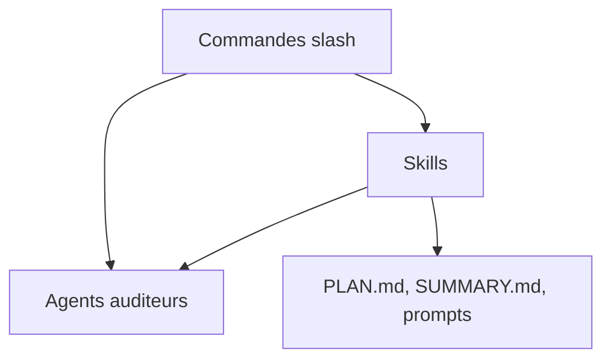

# glittercowboy/taches-cc-resources

> Collection de commandes, skills et agents Claude Code pour planifier, déboguer et créer des extensions.

## Le problème
Claude Code sans méthode dérive : prompts non structurés, contexte perdu d'une session à l'autre, extensions écrites à la main.

## Ce que ça fait vraiment
Le dépôt livre 27 commandes slash, 9 skills et 3 agents auditeurs. On y trouve du méta-prompting (`/create-prompt`, `/run-prompt`), des todos avec contexte, un document de reprise `/whats-next`, des modèles de pensée (`/consider:*`), un débogage méthodique et un setup de boucle Ralph. Des skills génèrent d'autres skills, commandes, sous-agents et hooks.

## Comment c'est branché
Schéma simplifié d'après la fiche, sans diagramme fourni.


## Essayer
```bash
claude plugin marketplace add glittercowboy/taches-cc-resources
claude plugin install taches-cc-resources
```

## Coût et pièges
Gratuit, mais tourne sur ton abonnement ou ta clé Claude Code. Installation manuelle : copie dans `~/.claude/commands/` et `~/.claude/skills/`. Plusieurs skills visent des bases de connaissances très longues.

## Ce que ce n'est pas
Pas un logiciel autonome : ce sont des prompts pour Claude Code. Aucune mesure de gain n'est donnée.

## Alternatives
Aucune alternative nommée dans le README, hormis create-meta-prompts contre create-plans en interne.

## Pour toi
À surveiller : bon réservoir d'idées pour structurer tes propres skills ; pioche ce qui sert plutôt que d'installer en bloc.

