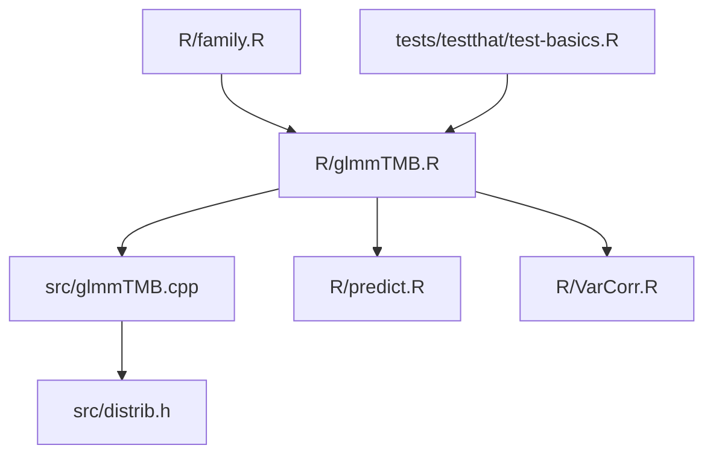

# glmmTMB/glmmTMB

> R package for fitting generalized linear mixed models, with zero-inflation, for statisticians and data scientists.

## The problem
Standard mixed models handle count data with excess zeros, variable dispersion and autocorrelation poorly.

## What it actually does
glmmTMB fits GLMMs on Template Model Builder (CppAD, Eigen). It supports several families (Gaussian, Poisson, binomial, negative binomial, Beta). It allows fixed and random effects on the conditional component and on zero-inflation, and fixed effects on dispersion. User help is mostly on the GitHub Pages site.

## How it is wired
Diagram based on the code diagram.

## Trying it
No installation command in the README, which points to the documentation site.

## Cost and gotchas
Free. You need R and a C++ compiler for the development version. The license is not declared in the catalog. Questions go to the dedicated mailing lists.

## What it is not
It is not a predictive machine learning tool, but inferential statistics. The README does not explain usage: everything is on the site.

## Alternatives
No alternative named in the README.

## For you
Worth watching: a reference if you do applied statistics in R, of little use for pure ML.
