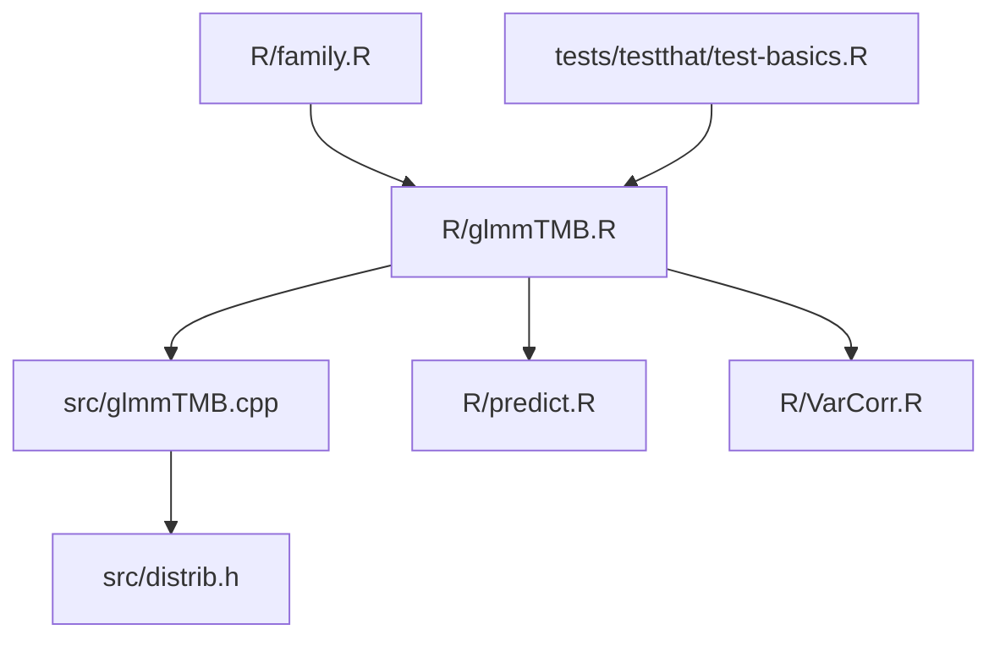

# glmmTMB/glmmTMB

> Paquet R pour ajuster des modèles linéaires mixtes généralisés, avec zéro-inflation, pour statisticiens et data scientists.

## Le problème
Les modèles mixtes standard gèrent mal les comptages en excès de zéros, la dispersion variable et l'autocorrélation.

## Ce que ça fait vraiment
glmmTMB ajuste des GLMM sur Template Model Builder (CppAD, Eigen). Il gère plusieurs familles (gaussienne, Poisson, binomiale, binomiale négative, Beta). Il permet effets fixes et aléatoires sur la composante conditionnelle et la zéro-inflation, et des effets fixes sur la dispersion. L'aide utilisateur est surtout sur le site GitHub Pages.

## Comment c'est branché
Schéma d'après le diagramme du code.

## Essayer
Aucune commande d'installation dans le README, qui renvoie au site de documentation.

## Coût et pièges
Gratuit. Il faut R et un compilateur C++ pour la version de développement. La licence n'est pas déclarée dans le catalogue. Les questions vont aux listes dédiées.

## Ce que ce n'est pas
Ce n'est pas un outil de machine learning prédictif, mais de la statistique inférentielle. Le README n'explique pas l'usage : tout est sur le site.

## Alternatives
Aucune alternative nommée dans le README.

## Pour toi
À surveiller : référence si tu fais de la statistique appliquée en R, peu utile pour du ML pur.

