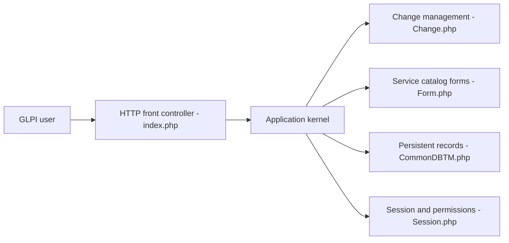

# glpi-project/glpi

> Free software for IT asset management and ITIL service desk, for IT teams.

## The problem
Tracking inventory, tickets, contracts and licenses of an IT estate in a single tool.

## What it actually does
PHP web application: inventory (dynamic since version 10), incidents, problems, changes, knowledge base, contracts, finance, reservations, DCIM, service catalog, separation by entities, projects, intervention planning, plugins and marketplace. The code confirms the front controller, the form conditions and the import preview.

## How it is wired


## Trying it
The README provides no command; it lists prerequisites: web server, MariaDB ≥ 10.11 or MySQL ≥ 8.0, PHP ≥ 8.3 and extensions.

```bash
# non documenté dans le README : télécharger l'archive de release
```

## Cost and gotchas
Free; free demo via glpi-network.cloud. 459 open issues.

## What it is not
Not an observability or monitoring tool.

## Alternatives
No alternative named in the README.

## For you
Ignore: IT asset management unrelated to data/AI/MLOps.
