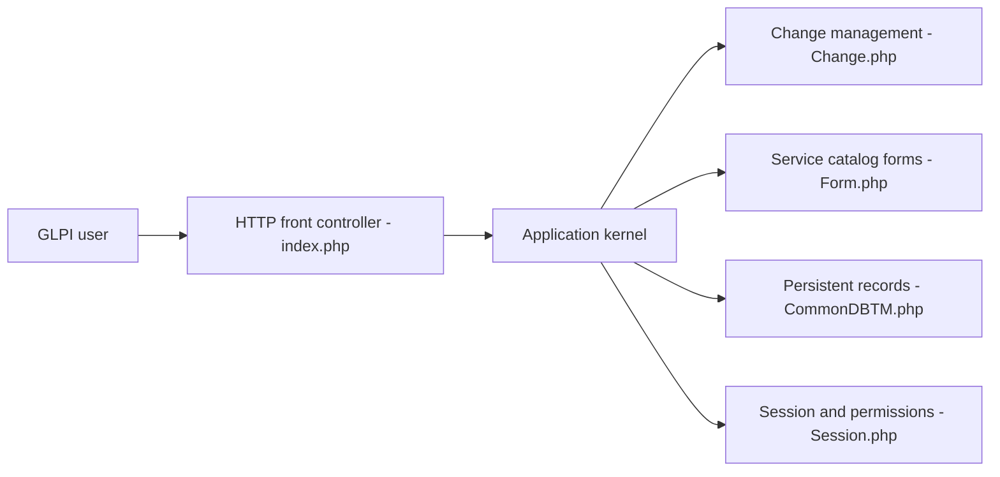

# glpi-project/glpi

> Logiciel libre de gestion de parc informatique et de centre de services ITIL, pour équipes IT.

## Le problème
Suivre inventaire, tickets, contrats et licences d'un parc informatique dans un seul outil.

## Ce que ça fait vraiment
Application web PHP : inventaire (dynamique depuis la version 10), incidents, problèmes, changements, base de connaissances, contrats, finances, réservations, DCIM, catalogue de services, séparation par entités, projets, planification d'interventions, plugins et marketplace. Le code confirme le contrôleur frontal, les conditions de formulaire et l'aperçu d'import.

## Comment c'est branché


## Essayer
Le README ne fournit pas de commande ; il liste des prérequis : serveur web, MariaDB ≥ 10.11 ou MySQL ≥ 8.0, PHP ≥ 8.3 et extensions.

```bash
# non documenté dans le README : télécharger l'archive de release
```

## Coût et pièges
Gratuit ; démonstration gratuite via glpi-network.cloud. 459 issues ouvertes.

## Ce que ce n'est pas
Pas un outil d'observabilité ou de supervision.

## Alternatives
Aucune alternative nommée dans le README.

## Pour toi
À ignorer : gestion de parc IT sans rapport avec data/IA/MLOps.

