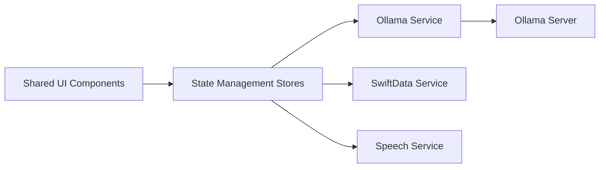

# gluonfield/enchanted

> ChatGPT-style client for iOS, macOS and visionOS for self-hosted models via Ollama.

## The problem
Talking to your Ollama models from an iPhone or a Mac requires a native interface that does not exist by default.

## What it actually does
SwiftUI app connected to an Ollama server (v0.1.14+): local history (SwiftData), Markdown, image attachments.
Voice prompts and read-aloud, system prompt, custom prompt templates.
Spotlight panel on macOS (Ctrl+⌘+K).

## How it is wired


## Trying it
```bash
ngrok http 11434 --host-header="localhost:11434"
```
Then install the app from the App Store and enter the server URL.

## Cost and gotchas
The app is free; you need a reachable Ollama server, often exposed through ngrok, which opens your server to the Internet.

## What it is not
Not a model server. The README announces that the project has a new iteration, Jaz.

## Alternatives
- Jaz: new iteration of the project according to the README.

## For you
Ignore: a simple consumer client; for professional use of Ollama, the direct API or a web UI is enough.
