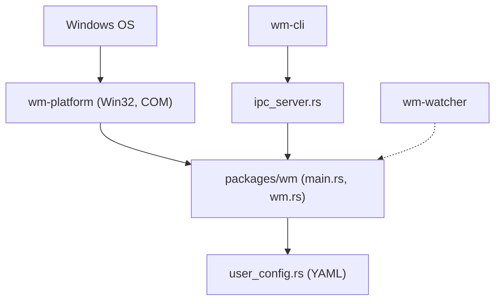

# glzr-io/glazewm

> Tiling window manager for Windows, inspired by i3, keyboard-driven.

## The problem
Windows arranges windows poorly: organizing several screens with the mouse takes time.

## What it actually does
Tiles windows by workspace, with keyboard shortcuts configurable in YAML. Applies per-window rules (process, class, title), gaps, borders (Windows 11 only) and binding modes. Integrates with Zebar as a status bar. Written in Rust with a local IPC.

## How it is wired


## Trying it
```bash
winget install GlazeWM
choco install glazewm
scoop bucket add extras
scoop install extras/glazewm
./glazewm.exe start --config="C:\<PATH_TO_CONFIG>\config.yaml"
```

## Cost and gotchas
Free. Windows only. The README notes that the Windows key is hard to remap: it recommends Alt. No native automatic layout. 428 open issues.

## What it is not
It is not a manager for Linux or macOS, nor a complete graphical overlay: without the Zebar status bar, there is no built-in display.

## Alternatives
No alternative named in the README.

## For you
Workstation comfort on Windows, unrelated to data/AI/MLOps: ignore for your watch, but relevant if you work with multiple screens on Windows.
