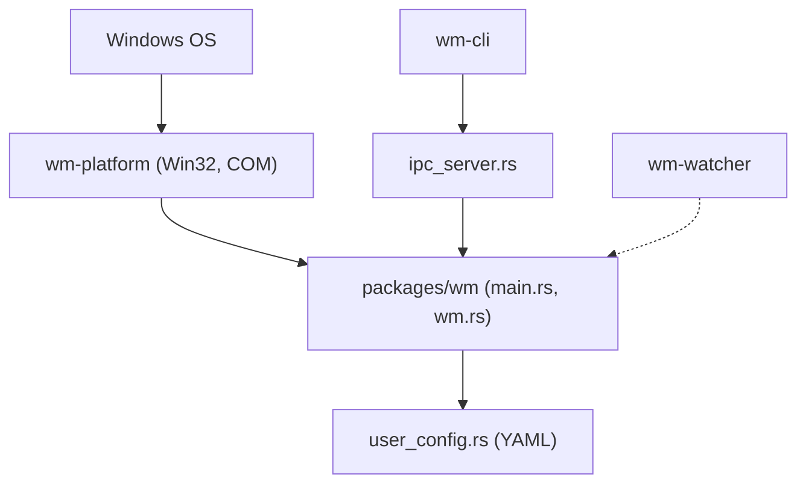

# glzr-io/glazewm

> Gestionnaire de fenêtres en mosaïque pour Windows, inspiré d'i3, piloté au clavier.

## Le problème
Windows range mal les fenêtres : organiser plusieurs écrans à la souris prend du temps.

## Ce que ça fait vraiment
Place les fenêtres en mosaïque, par espaces de travail, avec raccourcis clavier configurables en YAML. Applique des règles par fenêtre (processus, classe, titre), des écarts, des bordures (Windows 11 seulement) et des modes de liaison. S'intègre à Zebar comme barre d'état. Écrit en Rust avec un IPC local.

## Comment c'est branché


## Essayer
```bash
winget install GlazeWM
choco install glazewm
scoop bucket add extras
scoop install extras/glazewm
./glazewm.exe start --config="C:\<PATH_TO_CONFIG>\config.yaml"
```

## Coût et pièges
Gratuit. Windows uniquement. Le README note que la touche Windows est difficile à remapper : il recommande Alt. Pas de mise en page automatique native. 428 issues ouvertes.

## Ce que ce n'est pas
Ce n'est pas un gestionnaire pour Linux ou macOS, ni une surcouche graphique complète : sans barre d'état Zebar, il n'y a pas d'affichage intégré.

## Alternatives
Aucune alternative nommée dans le README.

## Pour toi
Confort de poste de travail sous Windows, sans lien avec data/IA/MLOps : à ignorer pour la veille, mais pertinent si tu travailles en multi-écrans sous Windows.

