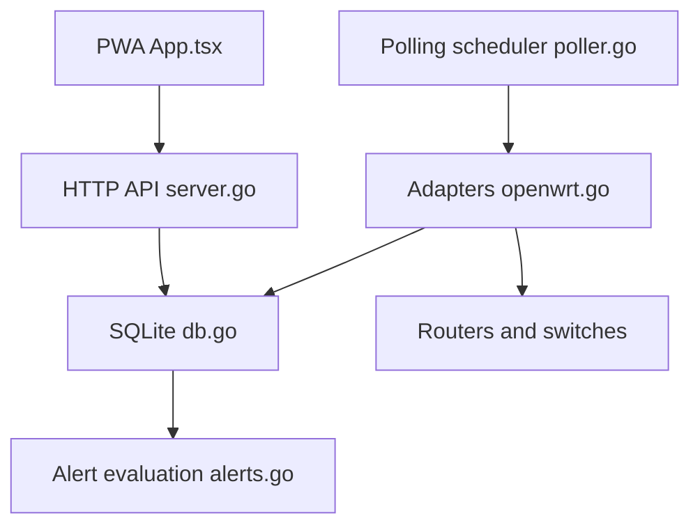

# gnacho/netpulse

> Self-hosted monitoring for home OpenWrt routers with topology, health score, and alerts, no cloud.

## The problem
Seeing the state of several routers, the network topology, and connected clients requires scattered tools.

## What it actually does
A single Go server, with an embedded React PWA and SQLite, queries routers over SSH and via a `netpulse-agent`. It infers topology from FDB and LLDP tables, computes a 0-to-100 health score updated via SSE, runs throughput tests, and sends alerts (Web Push, ntfy, Telegram). It exposes a read-only MCP server, disabled by default, and optionally publishes to MQTT and Home Assistant.

## How it is wired



## Trying it
```bash
curl -fsSL --retry 3 -o /tmp/netpulse-install.sh https://raw.githubusercontent.com/gnacho/netpulse/main/install.sh && sh /tmp/netpulse-install.sh
DEMO_MODE=1 AUTH_PASS=choose-one ./netpulse
docker run -d --name netpulse -p 127.0.0.1:3000:3000 -e AUTH_PASS=choose-one -v netpulse-data:/data --restart unless-stopped ghcr.io/gnacho/netpulse:latest
```

## Cost and gotchas
Free; a Linux machine with systemd is enough. Routers must accept the server's SSH key. The MCP token gives access to the entire network state: keep it on the LAN. AGPL-3.0 license.

## What it is not
Not a cloud or multi-site tool. MikroTik, Asuswrt, OPNsense, and UniFi integrations live in separate repos, with fewer features.

## Alternatives
No alternative named in the README.

## For you
To ignore for a data/AI/MLOps profile: this is home network monitoring, useful only if you have an OpenWrt fleet.
