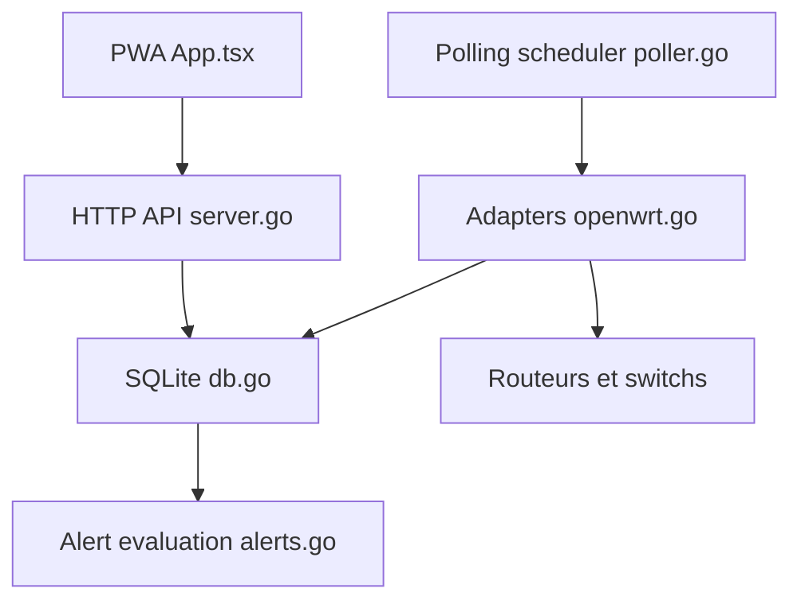

# gnacho/netpulse

> Supervision auto-hébergée de routeurs domestiques OpenWrt avec topologie, score de santé et alertes, sans cloud.

## Le problème
Voir l'état de plusieurs routeurs, la topologie du réseau et les clients connectés demande des outils dispersés.

## Ce que ça fait vraiment
Un serveur Go unique, avec une PWA React embarquée et SQLite, interroge les routeurs en SSH et via un agent `netpulse-agent`. Il déduit la topologie des tables FDB et LLDP, calcule un score de santé de 0 à 100 mis à jour par SSE, lance des tests de débit et envoie des alertes (Web Push, ntfy, Telegram). Il expose un serveur MCP en lecture seule, désactivé par défaut, et publie vers MQTT et Home Assistant en option.

## Comment c'est branché



## Essayer
```bash
curl -fsSL --retry 3 -o /tmp/netpulse-install.sh https://raw.githubusercontent.com/gnacho/netpulse/main/install.sh && sh /tmp/netpulse-install.sh
DEMO_MODE=1 AUTH_PASS=choose-one ./netpulse
docker run -d --name netpulse -p 127.0.0.1:3000:3000 -e AUTH_PASS=choose-one -v netpulse-data:/data --restart unless-stopped ghcr.io/gnacho/netpulse:latest
```

## Coût et pièges
Gratuit ; une machine Linux avec systemd suffit. Les routeurs doivent accepter la clé SSH du serveur. Le jeton MCP donne accès à tout l'état du réseau : à garder sur le LAN. Licence AGPL-3.0.

## Ce que ce n'est pas
Pas un outil cloud ni multi-site. Les intégrations MikroTik, Asuswrt, OPNsense et UniFi passent par des dépôts séparés, avec moins de fonctions.

## Alternatives
Aucune alternative nommée dans le README.

## Pour toi
À ignorer pour un profil data/IA/MLOps : c'est de la supervision de réseau domestique, utile seulement si tu as un parc OpenWrt.

