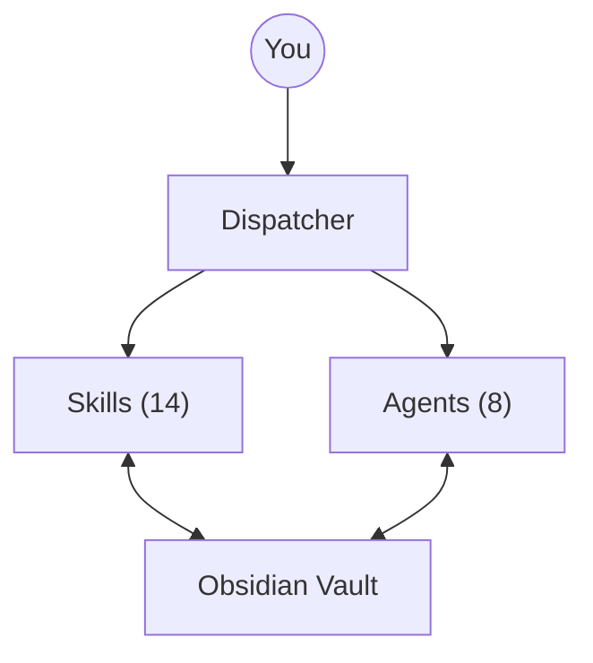

# gnekt/My-Brain-Is-Full-Crew

> Team of AI agents and skills that tidy an Obsidian vault through conversation, for overwhelmed researchers.

## The problem
An Obsidian second brain demands constant manual tidying, which overloaded people end up abandoning.

## What it actually does
Eight agents (Architect, Scribe, Sorter, Seeker, Connector, Librarian, Transcriber, Postman) and fourteen skills driven by a dispatcher. They capture notes, file them, search with citations, spot links, transcribe meetings and sort Gmail or Hey mail and the calendar. An installer adapts everything to Claude Code, Gemini CLI, OpenCode or Codex CLI. Replies in the user's language.

## How it is wired


## Trying it
```bash
cd /path/to/your-vault
git clone https://github.com/gnekt/My-Brain-Is-Full-Crew.git
cd My-Brain-Is-Full-Crew
bash scripts/launchme.sh
```
Then open the agent platform in the vault and say "Initialize my vault".

## Cost and gotchas
Requires a subscription or key for the chosen agent platform, and for mail the Google Workspace CLI (`gws`), Hey CLI or read-only MCP connectors. The README imposes acceptance of terms of use and reminds you of GDPR responsibility for third-party data. Back up your vault.

## What it is not
Not a simple capture tool: it acts on your mail and your vault. No warranty, and custom agents are your responsibility. A license is present but not identified by GitHub.

## Alternatives
No alternative named in the README.

## For you
Worth watching: a good idea for driving a vault with agents, but unclear license, a single maintainer and mail access to weigh before adopting it.
