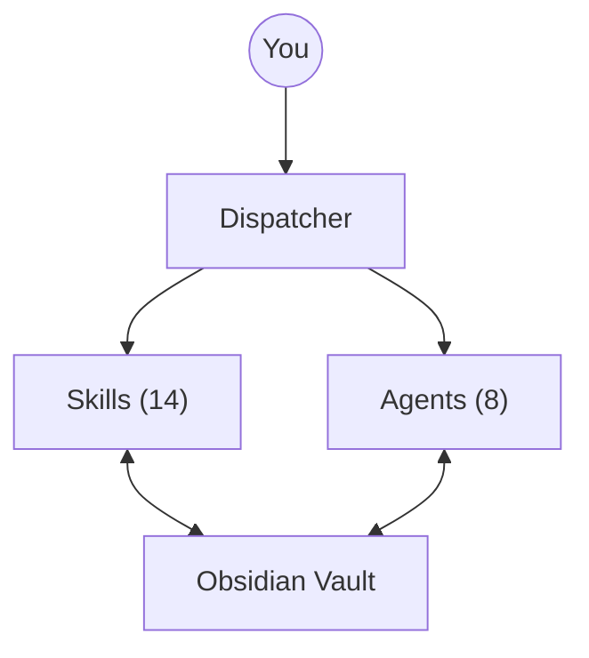

# gnekt/My-Brain-Is-Full-Crew

> Équipe d'agents IA et de skills qui rangent un coffre Obsidian par la conversation, pour chercheurs débordés.

## Le problème
Un second cerveau Obsidian demande un rangement manuel permanent, que les personnes surchargées finissent par abandonner.

## Ce que ça fait vraiment
Huit agents (Architect, Scribe, Sorter, Seeker, Connector, Librarian, Transcriber, Postman) et quatorze skills pilotés par un dispatcher. Ils capturent des notes, les classent, cherchent avec citations, repèrent des liens, transcrivent des réunions et trient les mails Gmail ou Hey et le calendrier. Un installeur adapte le tout à Claude Code, Gemini CLI, OpenCode ou Codex CLI. Réponses dans la langue de l'utilisateur.

## Comment c'est branché


## Essayer
```bash
cd /path/to/your-vault
git clone https://github.com/gnekt/My-Brain-Is-Full-Crew.git
cd My-Brain-Is-Full-Crew
bash scripts/launchme.sh
```
Puis ouvrir la plateforme d'agent dans le coffre et dire « Initialize my vault ».

## Coût et pièges
Demande un abonnement ou une clé pour la plateforme d'agent choisie, et pour les mails la CLI Google Workspace (`gws`), Hey CLI ou des connecteurs MCP en lecture seule. Le README impose une acceptation de conditions d'utilisation et rappelle la responsabilité RGPD pour les données tierces. Sauvegarde ton coffre.

## Ce que ce n'est pas
Pas un simple outil de capture : il agit sur tes mails et ton coffre. Pas de garantie, et les agents personnalisés relèvent de ta responsabilité. Licence présente mais non identifiée par GitHub.

## Alternatives
Aucune alternative nommée dans le README.

## Pour toi
À surveiller : bonne idée de pilotage d'un coffre par agents, mais licence floue, mainteneur unique et accès aux mails à peser avant de l'adopter.

