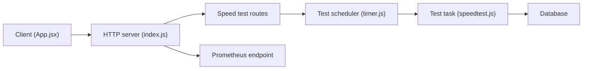

# gnmyt/MySpeed

> Application that measures and records the speed of your internet connection, with statistics and alerts.

## The problem
A one-off speed test shows neither the trend nor the outages of an internet provider.

## What it actually does
It runs tests scheduled by cron expression with Ookla, LibreSpeed or Cloudflare, and keeps the results for the chosen duration. It displays throughput, ping and statistics. It sends alerts by e-mail, Signal, WhatsApp or Telegram, and exposes a Prometheus endpoint for Grafana. Several nodes can be managed.

## How it is wired

## Trying it
The README gives no command: it points to installation guides for Linux and Windows.

## Cost and gotchas
Free. The tests consume bandwidth on each run, and the test servers are third-party services. About 89 open issues.

## What it is not
Not a full network monitoring tool. The links between some features (notifications, nodes) and the code have not been verified.

## Alternatives
No alternative named in the README.

## For you
Worth watching if you want to track the quality of your connection: the Prometheus/Grafana link fits well into an MLOps homelab.
