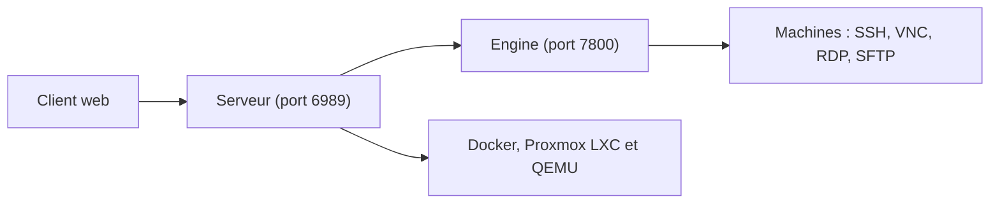

# gnmyt/Nexterm

> Self-hosted web interface for managing your servers over SSH, VNC, RDP and SFTP.

## The problem
Administering several servers means juggling SSH, RDP and VNC clients and file transfers.

## What it actually does
A single web server: remote connections over SSH, VNC and RDP, SFTP, Docker application deployment, management of Proxmox LXC and QEMU containers. Two-factor authentication, OIDC SSO, organizations to separate users and servers. An AI assistant exists (system prompt configurable via `AI_SYSTEM_PROMPT`), with no further detail.

## How it is wired
Simplified diagram based on the sheet, no diagram provided.

No diagram provided. Architecture described in the README: a server (port 6989) and a web client, plus an engine reachable on port 7800. Images `nexterm/aio`, `nexterm/server`, `nexterm/engine`. FlatBuffers schemas generated at build time.

## Trying it
```sh
git clone https://github.com/gnmyt/Nexterm.git
cd Nexterm
cp .env.example .env
openssl rand -hex 32
yarn install && cd client && yarn install && cd ..
yarn schema:generate
yarn dev
yarn dev:engine
```
The production installation is a link not detailed in the README.

## Cost and gotchas
Free. `ENCRYPTION_KEY` is mandatory; set `TRUST_PROXY` only if a proxy provides `X-Forwarded-For`. It stores access to your servers: expose it with caution.

## What it is not
Not a data or AI tool. Not a monitoring or orchestration tool.

## Alternatives
No alternative named in the README.

## For you
Ignore for your data / AI / MLOps profile: it is general-purpose server administration, useful only if you want a home-made web bastion.
