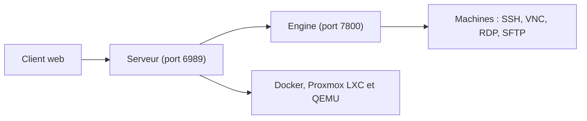

# gnmyt/Nexterm

> Interface web auto-hébergée pour gérer ses serveurs en SSH, VNC, RDP et SFTP.

## Le problème
Administrer plusieurs serveurs oblige à jongler entre clients SSH, RDP, VNC et transferts de fichiers.

## Ce que ça fait vraiment
Un seul serveur web : connexions distantes SSH, VNC et RDP, SFTP, déploiement d'applications Docker, gestion de conteneurs Proxmox LXC et QEMU. Double authentification, SSO OIDC, organisations pour séparer utilisateurs et serveurs. Un assistant IA existe (prompt système configurable par `AI_SYSTEM_PROMPT`), sans autre détail.

## Comment c'est branché
Schéma simplifié d'après la fiche, sans diagramme fourni.

Pas de diagramme fourni. Architecture décrite dans le README : un serveur (port 6989) et un client web, plus un moteur (« engine ») joignable sur le port 7800. Images `nexterm/aio`, `nexterm/server`, `nexterm/engine`. Schémas FlatBuffers générés au build.

## Essayer
```sh
git clone https://github.com/gnmyt/Nexterm.git
cd Nexterm
cp .env.example .env
openssl rand -hex 32
yarn install && cd client && yarn install && cd ..
yarn schema:generate
yarn dev
yarn dev:engine
```
L'installation de production est un lien non détaillé dans le README.

## Coût et pièges
Gratuit. `ENCRYPTION_KEY` obligatoire ; `TRUST_PROXY` à régler seulement si un proxy fournit `X-Forwarded-For`. Il stocke des accès à tes serveurs : à exposer avec précaution.

## Ce que ce n'est pas
Pas un outil data ou IA. Pas un outil de supervision ou d'orchestration.

## Alternatives
Aucune alternative nommée dans le README.

## Pour toi
À ignorer pour ton profil data / IA / MLOps : c'est de l'administration de serveurs généraliste, utile seulement si tu veux un bastion web maison.

