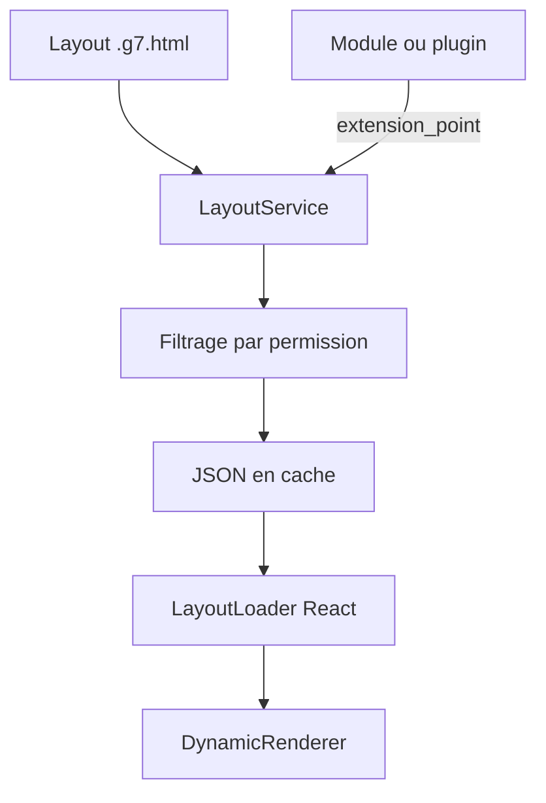

# gnuboard/g7

> Laravel and React CMS for communities and shops, designed to be extended by AI agents.

## The problem
Setting up a multilingual community or shop platform means rewriting access rights, payments and notifications.

## What it actually does
The Laravel 12 core handles rights (role, permission, scope), hooks, cache, notifications, identity verification and data retention. The interface is declared in `.g7.html`, compiled to JSON, then rendered by React. Modules (forum, e-commerce), plugins and language packs can be added without touching the core.

## How it is wired


## Trying it
```bash
git clone https://github.com/gnuboard/g7.git
cd g7
composer install --no-dev --optimize-autoloader
cp .env.example .env
```
Then open `/install` in the browser.

## Cost and gotchas
PHP 8.2 or later, MySQL 8 or MariaDB, Composer, a web server; Redis optional. The README mentions Korean identity-verification and payment services, often paid. Not in the prerequisites list: PHP.

## What it is not
It is not a data or AI tool. The license is present but not recognized by GitHub. Detailed documentation is in Korean. The README is truncated after the installation.

## Alternatives
No alternative named in the README, except Gnuboard 5, of which it is the successor.

## For you
Ignore: a PHP CMS unrelated to your field, with a license that needs clarifying.
