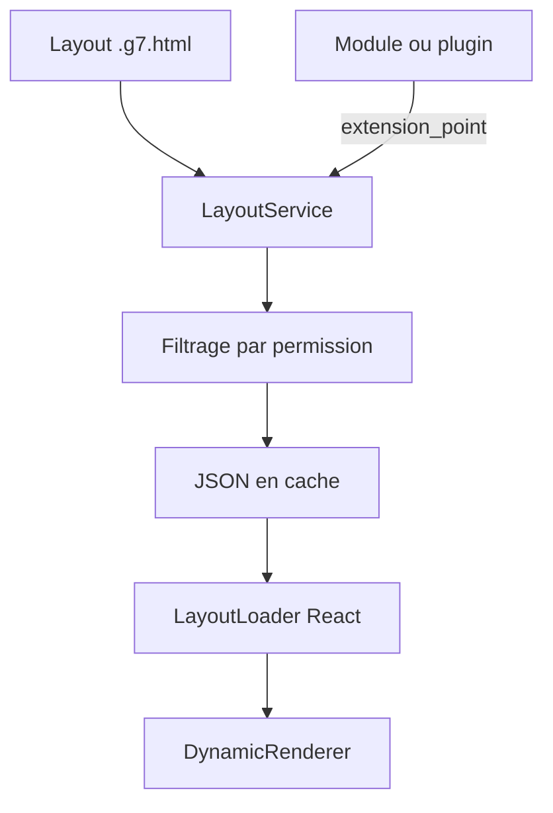

# gnuboard/g7

> CMS Laravel et React pour communautés et boutiques, conçu pour être étendu par des agents IA.

## Le problème
Monter une plateforme de communauté ou de boutique multilingue demande de recoder droits d'accès, paiements et notifications.

## Ce que ça fait vraiment
Le cœur Laravel 12 gère droits (rôle, permission, périmètre), hooks, cache, notifications, vérification d'identité et rétention de données. L'interface se déclare en `.g7.html`, compilée en JSON, puis rendue par React. Des modules (forum, e-commerce), plugins et packs de langue s'ajoutent sans toucher au cœur.

## Comment c'est branché


## Essayer
```bash
git clone https://github.com/gnuboard/g7.git
cd g7
composer install --no-dev --optimize-autoloader
cp .env.example .env
```
Puis ouvrir `/install` dans le navigateur.

## Coût et pièges
PHP 8.2 ou plus, MySQL 8 ou MariaDB, Composer, serveur web ; Redis optionnel. Le README parle de services de vérification d'identité coréens et de paiement, souvent payants. Hors liste : PHP.

## Ce que ce n'est pas
Ce n'est pas un outil data ou IA. La licence est présente mais non reconnue par GitHub. Documentation détaillée en coréen. Le README est tronqué après l'installation.

## Alternatives
Aucune alternative nommée dans le README, sauf Gnuboard 5 dont il est la suite.

## Pour toi
Ignorer : un CMS PHP sans rapport avec ton métier, à la licence à clarifier.

