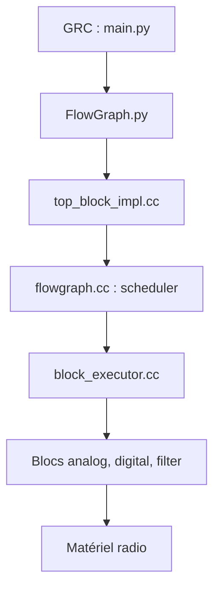

# gnuradio/gnuradio

> Signal processing toolkit and runtime for software-defined radio, for radio researchers and engineers.

## The problem
Building a radio processing chain requires chaining filters, demodulators and sample transfers by hand.

## What it actually does
Provides a flowgraph runtime and processing blocks (analog, digital, filters), with stream buffers, message queues and PMT types. GNU Radio Companion lets you build graphs visually. ControlPort exposes control interfaces. Used in software-defined radio, digital communications, particle physics and radio astronomy.

## How it is wired


## Trying it
```bash
sudo apt install gnuradio
gnuradio-companion --qt
```

## Cost and gotchas
Free. Installation through a distribution package, PPA or compilation; PyBOMBS is no longer recommended. The radio hardware (SDR) is a separate cost.

## What it is not
Not a lightweight Python library: the core is in C++. GNU Radio 4.0 is developed in another repository.

## Alternatives
GNU Radio 4.0, in its own official repository.

## For you
Ignore: radio signal domain, outside the scope of data, AI or MLOps unless you have a software-defined radio project.
