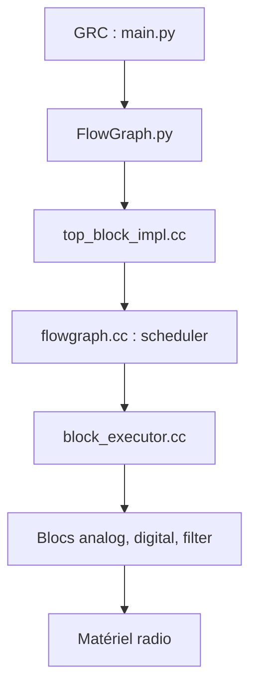

# gnuradio/gnuradio

> Boîte à outils de traitement du signal et runtime pour radio logicielle, pour chercheurs et ingénieurs radio.

## Le problème
Construire une chaîne de traitement radio exige d'enchaîner à la main filtres, démodulateurs et transferts d'échantillons.

## Ce que ça fait vraiment
Fournit un runtime de flowgraphs et des blocs de traitement (analogique, numérique, filtres), avec tampons de flux, files de messages et types PMT. GNU Radio Companion permet de construire les graphes visuellement. ControlPort expose des interfaces de contrôle. Utilisé en radio logicielle, communications numériques, physique des particules et radio-astronomie.

## Comment c'est branché


## Essayer
```bash
sudo apt install gnuradio
gnuradio-companion --qt
```

## Coût et pièges
Gratuit. Installation par paquet de distribution, PPA ou compilation ; PyBOMBS n'est plus recommandé. Le matériel radio (SDR) est un coût séparé.

## Ce que ce n'est pas
Ce n'est pas une bibliothèque Python légère : le cœur est en C++. Gnu Radio 4.0 est développé dans un autre dépôt.

## Alternatives
GNU Radio 4.0, dans son dépôt officiel dédié.

## Pour toi
À ignorer : domaine du signal radio, hors du périmètre data, IA ou MLOps sauf projet de radio logicielle.

