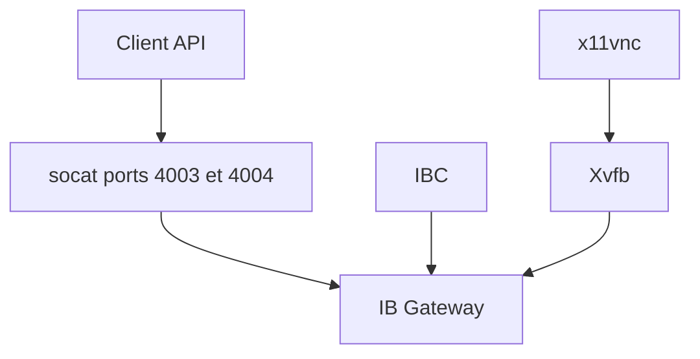

# gnzsnz/ib-gateway-docker

> Docker image that runs IB Gateway or TWS unattended, for algorithmic trading.

## The problem
IB Gateway is a graphical application that requires a manual login and a second factor, so it is hard to run on a server.

## What it actually does
The image bundles IB Gateway or TWS, IBC which simulates user input, Xvfb for the virtual screen, optional x11vnc and socat to relay the API port outside localhost. It handles live and paper modes, Docker secrets, an optional SSH tunnel and startup scripts. aarch64 support.

## How it is wired
Simplified diagram based on the fiche, no diagram provided.



## Trying it
```bash
# créer docker-compose.yml et .env (TWS_USERID, TWS_PASSWORD, TRADING_MODE=paper)
docker compose up
# pour TWS
docker compose -f tws-docker-compose.yml up
```

## Cost and gotchas
An Interactive Brokers account is required, and its credentials go in environment variables. The IB API is unencrypted TCP: do not expose the ports outside localhost without an SSH tunnel.

## What it is not
Not a trading strategy nor an API client: only the infrastructure to run the gateway. It does not bypass IB's two-factor authentication.

## Alternatives
No alternative named, apart from `jupyter-quant` to pair with it.

## For you
Worth watching: handy if you do automated quantitative trading with Interactive Brokers, useless otherwise.
