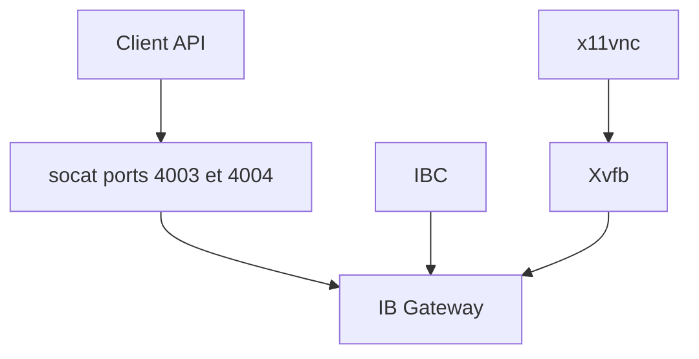

# gnzsnz/ib-gateway-docker

> Image Docker qui fait tourner IB Gateway ou TWS sans intervention humaine, pour le trading algorithmique.

## Le problème
IB Gateway est une application graphique qui demande une connexion manuelle et un second facteur, donc difficile à lancer sur un serveur.

## Ce que ça fait vraiment
L'image embarque IB Gateway ou TWS, IBC qui simule la saisie utilisateur, Xvfb pour l'écran virtuel, x11vnc optionnel et socat pour relayer le port API hors localhost. Elle gère les modes live et paper, les secrets Docker, un tunnel SSH optionnel et des scripts de démarrage. Support aarch64.

## Comment c'est branché
Schéma simplifié d'après la fiche, sans diagramme fourni.



## Essayer
```bash
# créer docker-compose.yml et .env (TWS_USERID, TWS_PASSWORD, TRADING_MODE=paper)
docker compose up
# pour TWS
docker compose -f tws-docker-compose.yml up
```

## Coût et pièges
Il faut un compte Interactive Brokers et ses identifiants en variables d'environnement. L'API IB est en TCP non chiffré : ne pas exposer les ports hors localhost sans tunnel SSH.

## Ce que ce n'est pas
Ce n'est pas une stratégie de trading ni un client API : seulement l'infrastructure pour exécuter la passerelle. Il ne contourne pas la double authentification d'IB.

## Alternatives
Aucune alternative nommée, hors `jupyter-quant` à associer.

## Pour toi
À surveiller : pratique si tu fais du trading quantitatif automatisé avec Interactive Brokers, inutile sinon.

