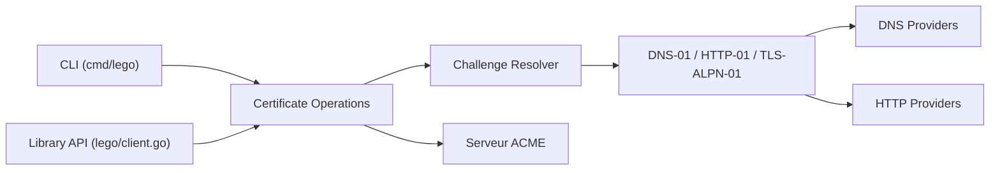

# go-acme/lego

> Go client and library for obtaining and renewing TLS certificates from Let's Encrypt and other ACME authorities.

## The problem
TLS certificates expire, and renewing them by hand ends up being forgotten. Proving you control a domain (HTTP, DNS, TLS-ALPN) is tedious as soon as DNS is hosted by a particular provider.

## What it actually does
Implements ACME v2 (RFC 8555): registration with the authority, obtaining, renewing and revoking certificates, with or without an existing CSR. Handles http-01, dns-01 and tls-alpn-01 challenges, and ships with more than 200 DNS providers (Cloudflare, Route 53, OVH, Gandi…). Usable on the command line or as a Go library. Also supports certificates for IP addresses and the ARI extension.

## How it is wired

## Trying it
The README documents no command: the Installation and Usage sections point to the documentation site (https://go-acme.github.io/lego/). No command is therefore reproduced here.

## Cost and gotchas
Free. You need an API credential from your DNS provider for the dns-01 challenge, and a domain you actually control. The ACME authority's rate limits apply.

## What it is not
Not a web server nor a deployment manager: it produces certificates, and it is up to you to install them and schedule renewal. The README details neither installation nor usage.

## Alternatives
No alternative named in the README.

## For you
Adopt if you automate certificates for internal services or MLOps pipelines: single binary, MIT license, very broad DNS support, and an active project (last push September 2026).
