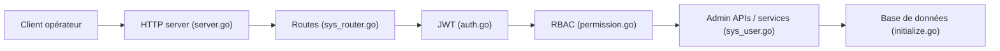

# go-admin-team/go-admin

> Admin back end in Go (Gin, Casbin, GORM) with a Vue front end, for quickly setting up a back office.

## The problem
Every back office rewrites the same building blocks: users, roles, menus, logs, CRUD generation.

## What it actually does
- REST API in Gin with JWT authentication and RBAC access control via Casbin.
- Management of users, departments, positions, menus, roles, dictionaries, parameters, logs.
- Generates CRUD code from tables, plus a form builder, server monitoring, scheduled tasks, files.
- `migrate` and `server` commands to initialize the database and launch the API; generated Swagger.

## How it is wired


## Trying it
```bash
git clone https://github.com/go-admin-team/go-admin.git
git clone https://github.com/go-admin-team/go-admin-ui.git
cd ./go-admin
go mod tidy
go build
./go-admin migrate -c config/settings.dev.yml
./go-admin server -c config/settings.yml
```

## Cost and gotchas
Free. Requires Go, Node v22+, pnpm, a database configured in `settings.yml`; on Windows, CGO/gcc is required for go-sqlite3. Two repositories (back + front) in the same folder. Unit tests still marked "TODO".

## What it is not
Not a data/AI platform: it is a general-purpose back-office skeleton. Documentation is mostly in Chinese/video.

## Alternatives
No alternative named in the README.

## For you
Ignore: generic, outside the data/AI/MLOps scope; useful only if you want a Go back office.
