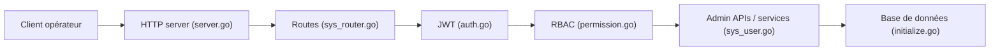

# go-admin-team/go-admin

> Back-end d'administration en Go (Gin, Casbin, GORM) avec front Vue, pour monter vite un back-office.

## Le problème
Chaque back-office réécrit les mêmes briques : utilisateurs, rôles, menus, journaux, génération de CRUD.

## Ce que ça fait vraiment
- API REST en Gin avec authentification JWT et contrôle d'accès RBAC via Casbin.
- Gestion des utilisateurs, départements, postes, menus, rôles, dictionnaires, paramètres, journaux.
- Génère le code CRUD à partir des tables, plus constructeur de formulaires, monitoring serveur, tâches planifiées, fichiers.
- Commandes `migrate` et `server` pour initialiser la base et lancer l'API ; Swagger généré.

## Comment c'est branché


## Essayer
```bash
git clone https://github.com/go-admin-team/go-admin.git
git clone https://github.com/go-admin-team/go-admin-ui.git
cd ./go-admin
go mod tidy
go build
./go-admin migrate -c config/settings.dev.yml
./go-admin server -c config/settings.yml
```

## Coût et pièges
Gratuit. Il faut Go, Node v22+, pnpm, une base de données configurée dans `settings.yml` ; sous Windows, CGO/gcc requis pour go-sqlite3. Deux dépôts (back + front) dans le même dossier. Tests unitaires encore en « TODO ».

## Ce que ce n'est pas
Pas une plateforme data/IA : c'est un squelette de back-office généraliste. La documentation est surtout en chinois/vidéo.

## Alternatives
Aucune alternative nommée dans le README.

## Pour toi
À ignorer : générique, hors du périmètre data/IA/MLOps ; utile seulement si tu veux un back-office Go.

