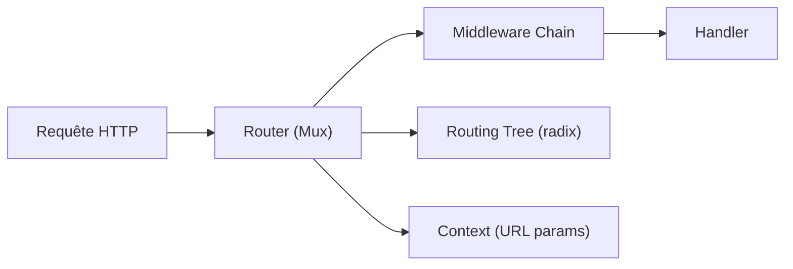

# go-chi/chi

> Lightweight, composable HTTP router for Go, net/http compatible, designed for large REST APIs.

## The problem
Go's standard multiplexer handles sub-routers, URL parameters and middleware chaining poorly in a large API.

## What it actually does
A router of about 1000 lines, based on a Patricia radix tree, with `Use`, `With`, `Group`, `Route`, `Mount`, named parameters and regular expressions. Provides a bundle of standard middlewares (Logger, Recoverer, Timeout, RequestID, Compress, Throttle…) and four `ClientIPFrom*` middlewares for the client IP; `RealIP` is marked deprecated (spoofing possible). No external dependency.

## How it is wired


## Trying it
```sh
go get -u github.com/go-chi/chi/v5
```

## Cost and gotchas
Free. Pick a single `ClientIPFrom*` middleware depending on the infrastructure; do not use `RealIP`. The README's benchmark figures date from 2020.

## What it is not
Not a full framework: no ORM or validation. It only covers routing and middlewares.

## Alternatives
No alternative named in the README (webrpc, gRPC, GraphQL are cited for going beyond REST).

## For you
Watch: a good choice if you expose a model behind a Go API; of no interest in Python.
