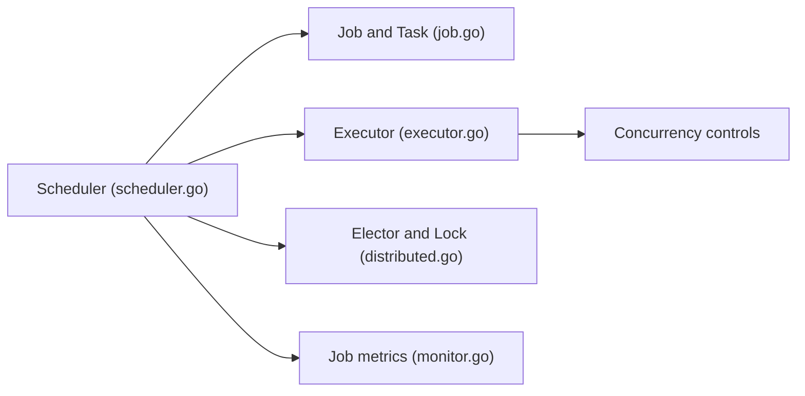

# go-co-op/gocron

> Go job scheduling library: run functions at fixed intervals or times.

## The problem
Run Go functions periodically with concurrency control, without depending on a system cron.

## What it actually does
Scheduler and executor: jobs by duration, random duration, cron, daily, weekly, monthly or one-off. Singleton mode, global concurrency limit, interval computed from the end of the job. Leader election and locks for multiple instances, event listeners, logging, metrics (no open-source implementation provided), mock clock for tests.

## How it is wired


## Trying it
```bash
go get github.com/go-co-op/gocron/v2
```
```go
s, _ := gocron.NewScheduler()
s.NewJob(gocron.DurationJob(10*time.Second), gocron.NewTask(func() {}))
s.Start()
```

## Cost and gotchas
Free. In-process scheduling: if the service stops, the jobs stop too. Locks and election must be wired in yourself (go-co-op implementations).

## What it is not
Not a workflow orchestrator (Airflow, etc.) nor a standalone service.

## Alternatives
None named in the README; gocron-ui for a web interface.

## For you
Watch: useful for lightweight periodic tasks in Go; for data pipelines, a dedicated orchestrator remains preferable.
