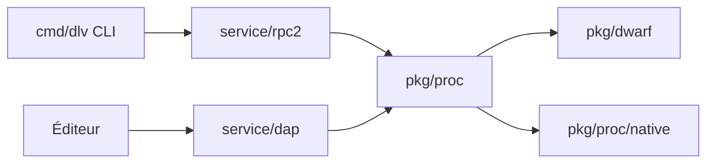

# go-delve/delve

> Debugger for the Go language, aimed at Go developers.

## The problem
Debugging Go with `Println` or with gdb, which is poorly suited to goroutines and Go types.

## What it actually does
Minimal README: a list of links and two sentences (a simple, full-featured debugger for Go). From the architecture described from the code: a `cmd/dlv` CLI client talks to a service (rpc2 / JSON-RPC or DAP for editors) on top of an engine (`pkg/proc`, `pkg/dwarf`, `pkg/gobuild`), with per-OS adapters (`pkg/proc/native`) and a Starlark REPL.

## How it is wired

## Trying it
No command documented in the provided README; see the project's website.

## Cost and gotchas
Free. The GitHub tracker is reserved for bugs (proposals go through the mailing list). The README mentions an AI usage policy.

## What it is not
Not a multi-language tool: it only debugs Go. The provided README exposes neither installation nor usage.

## Alternatives
No alternative named in the README.

## For you
Watch: the README material is insufficient to judge usage; useful only if you write Go (services, MLOps tooling), of no direct interest for Python data work.
