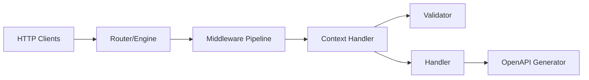

# go-fuego/fuego

> Go framework that generates OpenAPI documentation from the types in the code, for API developers.

## The problem
Classic Go frameworks do not infer OpenAPI schemas from signatures; the docs are maintained separately.

## What it actually does
Routing based on `net/http` (Go 1.22), generics to type input and output, JSON/XML/form (de)serialization, validation via go-playground/validator, `InTransform`/`OutTransform` transformations, RFC 9457 errors, rendering with `html/template`, templ or gomponents. Adapters for Gin and Echo. The README says "production-ready"; I have no proof of that in the text.

## How it is wired


## Trying it
```go
s := fuego.NewServer()
fuego.Get(s, "/", func(c fuego.ContextNoBody) (string, error) { return "Hello, World!", nil })
s.Run()
```
```bash
curl http://localhost:8088/std
```

## Cost and gotchas
Free; Go toolchain required. The README examples assume `fuego.NewServer()` and a port to configure.

## What it is not
Not an ORM or a front-end framework. Not a model inference tool.

## Alternatives
Chi, Gin, Fiber and Echo, cited as established frameworks but without OpenAPI inference from signatures.

## For you
Ignore, unless you expose models behind a Go API: outside the data/AI core, and no specific need here.
