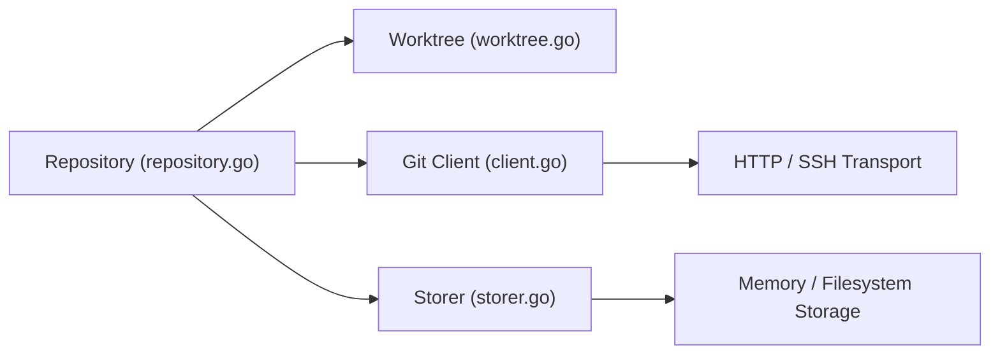

# go-git/go-git

> Pure Go implementation of Git, for manipulating repositories in Go programs.

## The problem
Using Git from Go without depending on the installed `git` binary.

## What it actually does
High-level API (clone, log, worktree) and low-level API (objects, packfiles, index, references, protocol). HTTP and SSH transports. Filesystem, in-memory or custom storage through `Storer`. Used by Keybase, Gitea, Pulumi, Prow, Flux (README). Partial parity with git, see the compatibility page.

## How it is wired


## Trying it
```go
import "github.com/go-git/go-git/v6"
_, err := git.PlainClone("/tmp/foo", &git.CloneOptions{URL: "https://github.com/go-git/go-git"})
```

## Cost and gotchas
Free. Some git features may be missing. Version v6 in the import.

## What it is not
Not a full Git client replacing `git`.

## Alternatives
None named (comparison is with git itself).

## For you
Watch: useful for Go tools that read repositories (CI, GitOps); in Python, use GitPython or the CLI.
