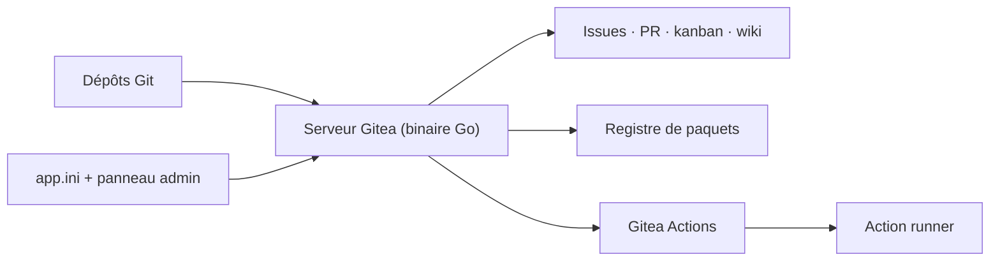

# go-gitea/gitea

> All-in-one self-hosted Git forge, written in Go.

## The problem
Hosting your code without depending on an external service means assembling Git, code review, issues, wiki, package registry and CI separately.

## What it actually does
A single service covering Git hosting, code management and review, issue tracking, project kanban, wiki, team collaboration, package registry and CI/CD — which can reuse GitHub Actions. Written in Go, so available on Linux, macOS, FreeBSD/OpenBSD and Windows, on x86, amd64, ARM, RISC-V 64 and PowerPC. An official go-sdk, a `tea` CLI and an actions runner complete the set.

## How it is wired


## Trying it
```bash
./gitea web
./gitea help
```

## Cost and gotchas
The software is free and self-hostable, via container (docker/podman) and the official image. Paid offerings exist: Gitea Cloud (free trial) and gitea.com as a free service limited in number of repositories. Configuration is split between the admin panel (dynamic) and `app.ini`, which requires a restart.

## What it is not
It is not an exact GitHub clone: reuse of GitHub Actions is announced but the runner is separate. Translations go through Crowdin, not direct PRs. The README defers most things to the external docs: neither build prerequisites nor sizing appear in it.

## Alternatives
- gitea/awesome-gitea: the list of third-party projects, if you are looking for an SDK, a theme or a plugin.

## For you
Adopt it to host your repositories and CI in-house, especially when the code must not leave the network.
