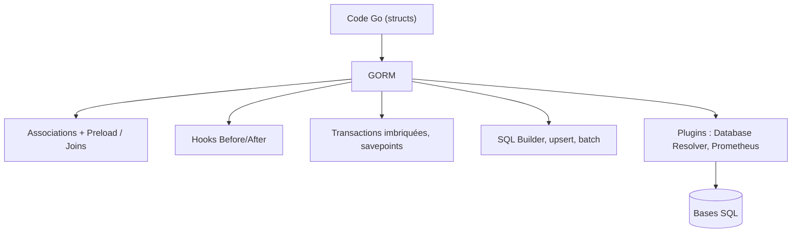

# go-gorm/gorm

> Full-featured Go ORM: associations, hooks, nested transactions, automatic migrations.

## The problem
Writing SQL by hand in Go for every table and every relation produces repetitive code
that is fragile to schema changes.

## What it actually does
Covers associations (has one, has many, belongs to, many to many, polymorphism, single-table
inheritance) and before/after hooks for create, save, update, delete, find.
Loads relations with `Preload` and `Joins`. Handles transactions, nested transactions,
savepoints and rollback to a given point.
Provides context, prepared statement mode, DryRun mode, batch insert, `FindInBatches`,
SQL builder, upsert, locking, optimizer and index hints, named arguments.
Composite primary keys, automatic migrations, logger, and an extensible plugin API
(database resolver for multi-database and read/write splitting, Prometheus).

## How it is wired


## Trying it
```bash
# Aucune commande d'installation dans le README : il renvoie à gorm.io.
```

## Cost and gotchas
Free. The README says nothing about supported databases or prerequisites: everything is deferred to the site.
No minimum Go version is given.

## What it is not
It is not documented here: the README is a feature list and two links,
which rules out any serious evaluation from the repository alone. It is not a code generator,
but a companion project `Gen` exists and has its own guides.

## Alternatives
- **Gen**: cited companion project, with its own guides.

## For you
Outside the data/AI scope, unless you write a Go service around your models.
