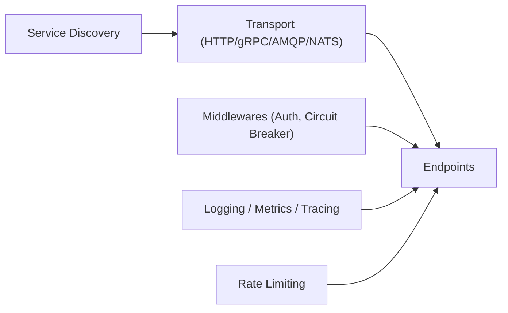

# go-kit/kit

> Go toolkit for building microservices: transports, observability, service discovery.

## The problem
Go provides primitives but few coherent building blocks for enterprise distributed systems: tracing, metrics, circuit breaker, discovery.

## What it actually does
A set of packages built around an endpoint model, with middlewares (basic auth, casbin, jwt, circuit breaker, rate limiting) and adapters for logging, metrics, tracing, several transports (HTTP, gRPC, AMQP, NATS, Lambda) and discovery (Consul, etcd, Eureka, DNS). RPC is the only messaging model targeted. It dictates no operations tooling.

## How it is wired

## Trying it
No installation command in the README; it points to the gokit.io site and states that Go kit is at major version 0 and compatible with Go modules.

## Cost and gotchas
Free. Last push on 2024-07-19, more than a year ago. Major version 0: no API stability guarantee. The code generators listed are third-party, one of them unmaintained.

## What it is not
It is not an opinionated framework: it is a set of building blocks to compose. It does not cover pub/sub or CQRS (outside its stated goals).

## Alternatives
- gizmo (New York Times): microservices toolkit, cited as an influence.
- go-micro: distributed systems framework.
- Kite: microservices framework.

## For you
Ignore: oriented toward Go services; your ML serving need is solved more simply otherwise, and the repo has had no push in over a year.
