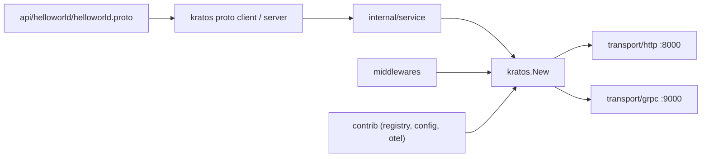

# go-kratos/kratos

> Lightweight Go framework for cloud-native microservices, API-first oriented.

## The problem
A Go service always starts from the same scaffolding: transport, middleware, configuration, logs, registry.
Maintaining HTTP and gRPC side by side doubles the transport code.

## What it actually does
API-first development: Protobuf files generate the HTTP and gRPC code, with OpenAPI and consistent errors.
Unified transport layer: one service exposes `http.NewServer` and `grpc.NewServer` in a single application.
Composable middlewares for recovery, logs, validation, tracing, metrics, authentication.
Logging based on the standard library's `log/slog`, OpenTelemetry extensions in the contrib packages.

## How it is wired


## Trying it
```shell
go install github.com/go-kratos/kratos/cmd/kratos/v3@latest
kratos upgrade
kratos new helloworld
cd helloworld
go mod tidy
kratos run
make test
make lint
```

## Cost and gotchas
Go 1.25 or later, plus `protoc` and `protoc-gen-go` installed: code generation is a prerequisite, not an option.
Kratos v3 makes behaviors that were implicit in v2 explicit: read the migration guide before touching a production service.

## What it is not
It is not a full-stack framework like Spring: the core is slim, integrations live in contrib.
It is not a runtime: no sidecar, no durable execution, only a library.
The README mentions neither license nor governance.

## Alternatives
go-kit/kit, go-micro, google/go-cloud, go-zero, beego: cited as influences, hence as direct comparables.

## For you
Of no interest to a data/AI profile: ignore unless you write Go services.
