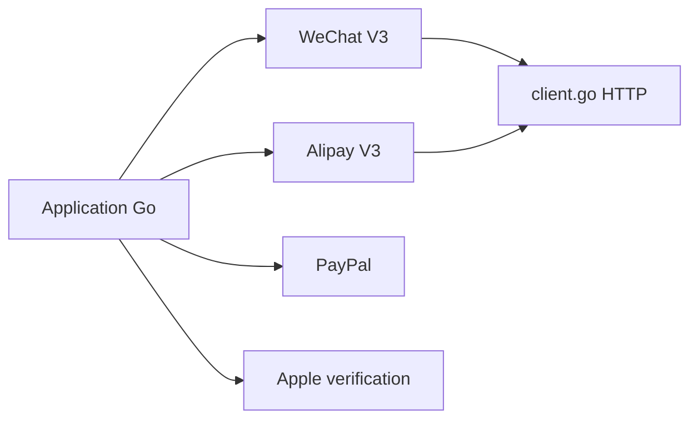

# go-pay/gopay

> Unified Go SDK for integrating WeChat, Alipay, Douyin, QQ, PayPal, Apple and other payments.

## The problem
Each Chinese payment platform has its own API, signatures and versions; integrating them one by one is expensive.

## What it actually does
Provides one Go client per provider: Alipay (classic and V3), WeChat Pay (V2 and V3), Douyin, QQ, CMB, Allinpay, Lakala, Saobei, PayPal and Apple receipt verification. A shared HTTP client (`pkg/xhttp`) serves all of them. Since v1.5.119, TLS certificate verification is enabled by default; the README explains how to disable it in a sandbox. Documentation is in Chinese.

## How it is wired


## Trying it
```bash
go get github.com/go-pay/gopay
```

## Cost and gotchas
Free, but each provider requires a merchant account. The README recommends testing in production with one cent. Do not disable TLS verification anywhere other than in a sandbox.

## What it is not
Not a payment gateway: it is a client SDK. The README is entirely in Chinese, and issues are handled by a single maintainer.

## Alternatives
No alternative named in the README.

## For you
Ignore: a Go payment SDK for the Chinese market, outside your data/AI scope.
