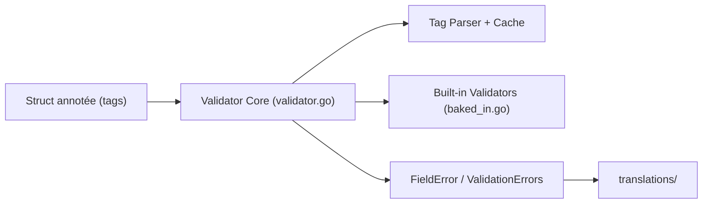

# go-playground/validator

> Go library that validates structs and fields from tags, for people writing APIs in Go.

## The problem
Manually checking every field of an incoming request (format, length, consistency between fields) produces repetitive, fragile code.

## What it actually does
You annotate struct fields with tags (`required`, `email`, `min`, `oneof`…) and `validate.Struct()` returns the errors. The README lists hundreds of built-in validations: network, strings, formats (UUID, JWT, ISBN, cron, semver), comparisons, cross-field checks, and aliases. It also handles diving into arrays and maps (`dive`), custom types, translated error messages, and serves as gin's default validator.

## How it is wired


## Trying it
```bash
go get github.com/go-playground/validator/v10
```
Then `validator.New(validator.WithRequiredStructEnabled())` in Go, recommended for new usages.

## Cost and gotchas
Free, MIT. The README issues a call for maintainers. The `WithRequiredStructEnabled` option will become the default behavior in v11; support follows Go's version policy.

## What it is not
Not a data schema nor a dataset validator: it validates in-memory Go structures. It does not handle DataFrames.

## Alternatives
No alternative cited in the README.

## For you
Ignore, unless your inference service is written in Go: outside that use, it brings nothing for a data / AI profile.
