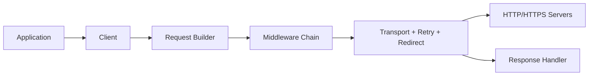

# go-resty/resty

> HTTP and REST client for Go, aimed at developers who call APIs.

## The problem
Go's standard HTTP client requires a lot of boilerplate code for requests, retries and authentication.

## What it actually does
The README is minimal: documentation at resty.dev, Go 1.23 minimum, versions v1 to v3 (`resty.dev/v3`). From the architecture described: client, request, response, middleware chain, transport, retries, redirects, authentication, debugging/tracing.

## How it is wired

## Trying it
No command in the README; points to resty.dev and godoc.

## Cost and gotchas
Free. Three major versions coexist, with different import paths. Short README, so this sheet has little material.

## What it is not
Not a server framework: a client only. Sole creator cited: Jeevanandam M.

## Alternatives
No alternative named in the README.

## For you
Keep an eye on it: handy if you write API clients in Go, of no direct interest for a Python profile.
