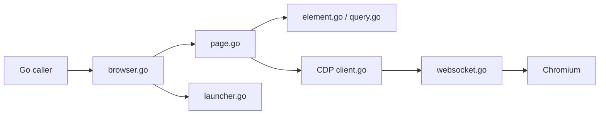

# go-rod/rod

> Go driver for Chrome via the DevTools Protocol, for web automation and scraping.

## The problem
Automating a browser in Go with waits, iframes, shadow DOM and zombie processes is tedious and fragile.

## What it actually does
High-level API (`Browser`, `Page`, `Element`) and reusable low-level layers (`lib/cdp`, `lib/proto`).
Chained context for timeouts/cancellation, automatic waiting for elements, network interception (`hijack.go`).
Automatic browser download via `lib/launcher`, no zombie process after a crash.
100% test coverage enforced in CI.

## How it is wired

## Trying it
No installation command documented in the README: it points to `examples_test.go` and the examples folder.

## Cost and gotchas
Free, MIT. Requires a Chromium browser (downloaded automatically).
Documentation mostly through tests and issues: steep entry curve.

## What it is not
Not a Python or Node tool: Go only.
Not a turnkey scraping service (proxies, anti-bot not documented).

## Alternatives
- Chromedp: another CDP driver in Go, compared in Rod's docs.

## For you
Watch: solid if you do scraping in Go, but your data ecosystem is probably Python (Playwright), so low priority.
