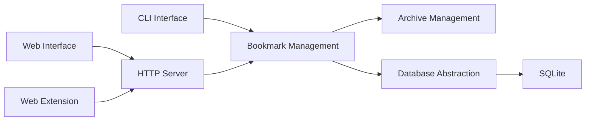

# go-shiori/shiori

> Self-hosted bookmark manager in Go, a simple Pocket clone, via CLI or web.

## The problem
"Read it later" bookmark services shut down or keep your data; you need a local, portable alternative.

## What it actually does
Add, edit, delete and search bookmarks from the command line or through a web interface.
Netscape-format import/export, import from Pocket.
Offline archive of the readable content of pages by default.
Single binary, SQLite, PostgreSQL, MariaDB or MySQL databases; browser extension in beta.

## How it is wired

## Trying it
No command in the README: it points to the docs folder.

## Cost and gotchas
Free, MIT; nothing else documented in the README.

## What it is not
Not an RSS reader nor a collaborative watch tool.
The browser extension is in beta.

## Alternatives
No alternative named in the README (Pocket is the tool being imitated, not an alternative).

## For you
Ignore: unrelated to data or AI, unless you want to archive watch articles locally.
