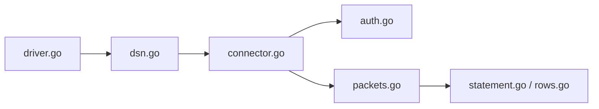

# go-sql-driver/mysql

> Pure Go MySQL/MariaDB driver for the `database/sql` package, for Go developers.

## The problem
A Go program needs to talk to MySQL through the standard `database/sql` interface, without C bindings.

## What it actually does
Implements `database/sql/driver`: DSN, authentication, packet protocol, prepared statements, result rows, transactions. Options: zlib compression, `time.Time` parsing, parameter interpolation, `LOAD DATA LOCAL INFILE` with an allow list. Supports MySQL 8.0+ and MariaDB 10.11+; TiDB by PingCAP.

## How it is wired


## Trying it
```bash
go get -u github.com/go-sql-driver/mysql
```
```go
db, err := sql.Open("mysql", "user:password@/dbname")
db.SetConnMaxLifetime(time.Minute * 3)
db.SetMaxOpenConns(10)
db.SetMaxIdleConns(10)
```

## Cost and gotchas
Free. Go 1.25 minimum. Set `SetConnMaxLifetime` (under 5 minutes), otherwise connections get cut on the server side. `allowAllFiles`, `tls=skip-verify` and `allowCleartextPasswords` are flagged as unsafe.

## What it is not
Not an ORM. Percona, CloudSQL and Sphinx work but are not supported by the maintainers. Not complete according to the README.

## Alternatives
No alternative named in the README.

## For you
Adopt it if you write Go that reads MySQL (pipelines, exporters): de facto standard, MPL-2.0 (file-level copyleft, no trouble in normal use).
